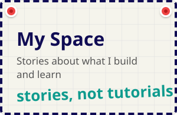
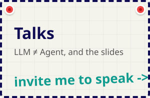
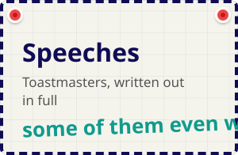

I'm Saai Syvendra. I build AI agents for a living, then talk about them on stage. I won [HackerRank Orchestrate](https://saai.syvendra.com/myspace/hackerrank-orchestrate) in May 2026, #1 of 12,885 registrants. Email me at saai@syvendra.com, or run `ssh ssh.syvendra.com` to see my portfolio in your terminal.

- **Latest post:** [The eMudhra CA compromise, explained](https://saai.syvendra.com/myspace/emudhra-compromise)
- **Latest talk:** [LLM ≠ Agent](https://saai.syvendra.com/talks/llm-is-not-an-agent), code at [saai-syvendra/llm-is-not-an-agent](https://github.com/saai-syvendra/llm-is-not-an-agent)
- **Find me:** [saai.syvendra.com](https://saai.syvendra.com) · [LinkedIn](https://www.linkedin.com/in/saai-syvendra/) · saai@syvendra.com
